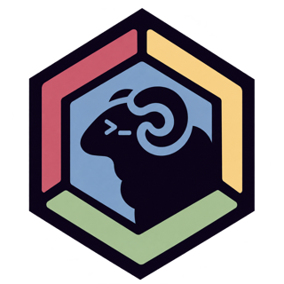

<h1 align="center">zaag</h1>

<p align="center"></p>

<p align="center">
  <a href="https://zellij.dev"></a>
  <a href="https://www.python.org/downloads/"></a>
  <a href="LICENSE"></a>
  <a href="https://github.com/IsmailHatim/zaag/stargazers"></a>
  <a href="https://github.com/IsmailHatim/zaag/commits"></a>
</p>


Coding agents in [zellij](https://zellij.dev): one zellij session per project, one pane per agent
(Claude Code, Codex, Hermes). zaag adds what zellij lacks for that:

- **`zaag`**, a command that lists the agents with their status, reads their screen, prompts them,
  sends keys and starts new ones, on this machine or on another over SSH (`bin/zaag`, Python,
  standard library only);
- **status hooks** for Claude Code, Codex and Hermes, so each agent reports `working`, `blocked`, `done`;
- **a zellij plugin** (`plugin/`, Rust → WebAssembly, prebuilt in `dist/`): a sidebar in every tab
  with the projects, their branch and the agents, and a searchable list of all of them;
- **a skill** (`skill/SKILL.md`) that teaches an agent to drive the others through `zaag`.

zellij itself is untouched: no fork, no patch.

## Install

Needs zellij 0.45 or later (tested on 0.45.1 and 0.46.0) and python3.

```bash
git clone https://github.com/IsmailHatim/zaag.git && cd zaag
./install.sh              # everything
./install.sh --no-plugin  # command, hooks and skill only (a machine reached over SSH)
./install.sh --build      # compile the plugin yourself (cargo + rustup target add wasm32-wasip1)
```

It links `~/.local/bin/zaag` to this folder (keep the folder), adds the hooks to
`~/.claude/settings.json` (and `~/.codex/hooks.json`, `~/.hermes/config.yaml` when Codex or Hermes
is installed; each asks once whether you trust the new hooks), links the skill
into each agent's skills folder, copies the plugin to `~/.local/share/zaag`, writes the `zaag` layout and
binds **Ctrl-o g** to the agents list in `~/.config/zellij/config.kdl`. Files it changes are
copied first as `*.before-zaag`. Run it again after `git pull`; a session that is already open
keeps the plugin it loaded until you run `zaag reload` in it.

## Use

```bash
zaag attach myproject     # opens the project (created with the sidebar if new); start claude, codex or hermes in it
```

- **Sidebar**: projects on top (dot = their most urgent agent, branch under the name), agents
  below, most urgent first: red ● blocked, green ● done, yellow ● working, ○ idle. Click a project
  or an agent to go there, also across sessions; **new** starts an agent in the current project,
  **menu** opens the list.
- **Ctrl-o g**, from any session: the list of every agent. Type to filter, ↑↓, Enter to go,
  Ctrl-e (or Alt-Enter) to type a prompt for the agent under the cursor and send it without
  leaving where you are, Ctrl-r to rename the agent or the project under the cursor, Ctrl-u / Ctrl-d to move its project
  up or down in the list (also `zaag move <project> up|down|top|bottom`), Esc to close.
- `zaag attach` without a name uses the current folder's name. It is `zellij attach --create`
  with the `zaag` layout: `zellij -s myproject --layout zaag` does the same for a new session.
- A plain `zellij` stays plain; a session opened without the layout gets the sidebar with
  `zellij action override-layout zaag`.

## The command

```bash
zaag attach [P]                                # open a project in this terminal
zaag list [--all] [--session P] [--machines]   # agents (with --all, plain terminals too)
zaag new [--session P] [--cwd D] [--name N] [--agent claude|codex|hermes|shell] [--prompt T] [--split right|down] [--focus] [-- agent options]
zaag get <id>                  # one agent: status, name, folder
zaag prompt <id> "text" [--wait] [--timeout S]
zaag read <id> [--lines N] [--full]
zaag keys <id> esc | enter | 1 | ctrl-c ...
zaag wait <id> [--until done,idle,blocked] [--timeout S]
zaag rename <id> "name"        zaag rename-session <old> <new>
zaag seen <id>                 # done → idle
zaag move <session> up|down|top|bottom
zaag focus <id>                zaag close <id>                zaag menu                zaag reload
zaag -m <ssh-host> <any of the above>
```

An id is `<session>:<pane>` (`webapp:4`) or `<session>:<name>` (`webapp:Reviewer`) when one pane has
that name. Everything answers `{"result": ...}` or
`{"error": {"code", "message"}}` on stdout; `read` prints text. `zaag new --session P` creates the
session in the background, with the sidebar, when it does not exist yet.

## Other agents

Claude Code, Codex and Hermes are set up by the installer (hooks, and the skill in each one's
skills folder, plus `~/.agents/skills` when it exists). Any other terminal agent works too:

```bash
zaag new --name helper --cmd "myagent --flag"      # listed, read, prompted like the others
```

Its status needs it to tell zaag what it is doing. From its own hooks (or a wrapper script), run
inside its pane:

```bash
zaag hook --agent myagent --event working    # also: start, blocked, done, idle, end
```

The skill is a plain `SKILL.md` (`skill/`): point any agent that reads such files at it.

## Other machines

List their SSH names in `~/.config/zaag/config.json` (`ZAAG_MACHINES=a,b` overrides it):

```json
{"machines": ["devbox"]}
```

Each needs zellij, this repo and `./install.sh --no-plugin`, and `ssh <name>` must work without a
password prompt. Their agents then show in the sidebar and the list within two seconds, grouped
by machine; an unreachable machine is shown as offline. Click a remote agent or project (or Enter
on it in the list) and it opens in a tab of the session you are in: that machine's zellij, over
SSH, with the agent's pane in front. From a terminal, `zaag -m <name> attach <session>` does the
same there. (A bare `ssh <name> zellij attach` often fails with "command not found": without a
login shell, `~/.local/bin` is not on the PATH. zaag asks the other machine's zaag, which knows
where its zellij is.) A zellij inside a zellij takes its keys after the outer one. zellij 0.46
notices the inner session and asks once how to control it ("on focus" suits a tab); Ctrl-o ] then
gives the keys back to the outer session and Ctrl-o [ to the inner one (with your own keybindings,
bind `FocusHostSession` and `FocusGuestSession`). On 0.45, lock the outer one (Ctrl-g) while you
work in the tab.

A session nobody is attached to is only 50 columns wide in zellij, so an agent's screen read from
there wraps every few words. zellij has no size option for a background session, but a session
keeps the size of its last client: when zaag creates a session, adds a pane to one, or reads from
one that nobody is attached to and that is narrow, it attaches for a moment on a 200x50 terminal
of its own.

## Statuses

| Status | Set by |
|---|---|
| `working` | a prompt submitted, a tool finished |
| `blocked` | a permission request, a question, or any dialog seen on screen |
| `done` | the turn ended; `done_seq` goes up by one |
| `idle` | a new session; a `done` agent once looked at; an interrupted turn |

They live in `~/.local/state/zaag/agents/<session>~<pane>.json`, written by `zaag hook`, which
the agents call on their own events (outside zellij it does nothing). Three things no hook
reports are read from the screen when the agents are listed: a dialog that is not a permission
request, a dialog that was answered, an interrupted turn. Codex has no "session ended" event: a
Codex that quit keeps its last status until its pane closes. Hermes runs its hooks from a
background service, so zaag finds the pane by the Hermes session, then by the folder it runs in.
Claude Code can also run a session in its own background service and only display it in a pane:
zaag ties the two by the pane's title, which is the session's name, or, for a pane you renamed,
by finding the session whose last words are on the pane's screen.

### On zellij 0.46

zellij 0.46 has an inbox: agents tell the terminal what they are doing (OSC 7501: working, blocked
with their question, done) and zellij gathers it. zaag reads that same state from zellij, so on
0.46 an agent that reports this way is listed with its status **without any hook**, and a blocked
agent's question shows in `zaag list` (`message`) and under its name in the sidebar. An agent whose
hooks have spoken keeps its hook status: hooks also cover what a program does not report, and they
are all there is on 0.45. Looking at a finished agent in zaag marks it seen in zellij's inbox too.
The inbox is where you answer what needs you; zaag is the list of every agent, the command they
drive each other with, and the other machines.

The plugin only draws what `zaag list --machines` answers, asked every 2 seconds while visible.

## Things zellij does

- A session nobody is attached to cannot build a new tab: there `zaag new` opens a pane instead.
  It cannot place a pane to the right of or below another one either: there `--split` opens the
  pane wherever zellij finds room.
- A new session inherits the environment of whoever created it; `zaag new` strips the calling
  agent's own variables first.

## Uninstall

Remove the `zaag hook` entries from `~/.claude/settings.json`, `~/.codex/hooks.json` and
`~/.hermes/config.yaml`, the
`bind "g"` block from `~/.config/zellij/config.kdl`, and delete `~/.local/bin/zaag`,
`~/.local/share/zaag`, `~/.local/state/zaag`, `~/.config/zaag`, `~/.claude/skills/zaag` and
`~/.config/zellij/layouts/zaag.kdl`.

## Development

```bash
python3 -m unittest discover -s tests
./build-plugin.sh        # rebuilds dist/zaag-sidebar.wasm
vhs demo/demo.tape       # records assets/demo.gif again, with stand-in agents in a throwaway zellij
```

If you only want a sidebar of Claude Code sessions, look at
[cc-deck](https://cc-deck.github.io/docs/cc-deck/0.1/index.html) too.

## Licence

MIT
